# Manual do usuário — Fênix | Controle Financeiro v1.0

Este manual mostra, passo a passo, como usar cada tela. Os exemplos usam a data de hoje como **02/11/2026**.

## 1. A ideia do aplicativo

O app mostra **quanto você tem, quanto deve, quanto vai receber e quando**. A regra principal é separar três coisas:

- **Realizado:** dinheiro que de fato entrou ou saiu.
- **Pendente:** conta ou recebimento que já deveria ter acontecido e ainda não foi confirmado.
- **Projetado:** movimento futuro esperado (só estimativa).

Por isso existem **dois saldos**, sempre no topo da tela:

| Saldo | O que é |
|---|---|
| **Saldo realizado** | Seu saldo inicial + o que você já recebeu − o que você já pagou. É o único que vale como "dinheiro disponível". |
| **Saldo projetado** | O saldo realizado + recebíveis previstos − débitos futuros e pendentes. É **estimativa**, nunca saldo do banco. |

O app **nunca marca nada como pago ou recebido sozinho**. Você sempre confirma.

## 2. Primeiro acesso

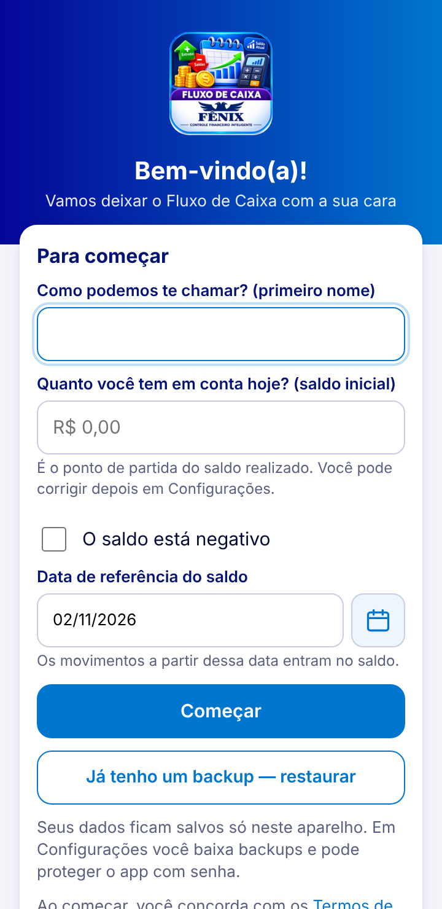

Na primeira vez o app pergunta:

1. **Como podemos te chamar?** Digite só o primeiro nome. Exemplo: `Cristiano`.
2. **Quanto você tem em conta hoje?** É o saldo inicial. Digite apenas os números: `800000` vira `R$ 8.000,00` (a máscara coloca vírgula e ponto sozinha). Exemplo: `80000` vira `R$ 800,00`.
3. **O saldo está negativo:** marque se você começa devendo ao banco.
4. **Data de referência do saldo:** o dia a que esse saldo se refere. Movimentos a partir dessa data entram na conta.
5. Toque em **Começar**.

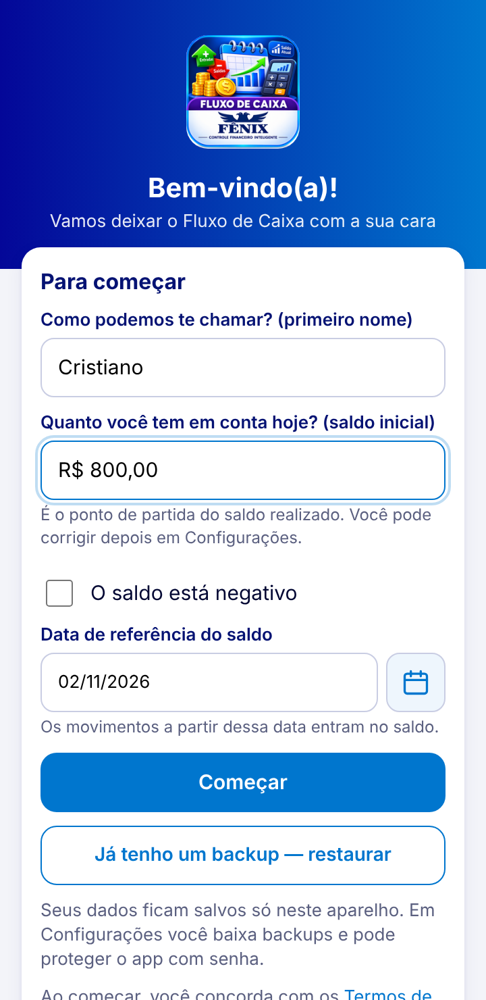

Se você já tem um backup, toque em **Já tenho um backup — restaurar** e escolha o arquivo `.json`.

## 3. Conhecendo a tela

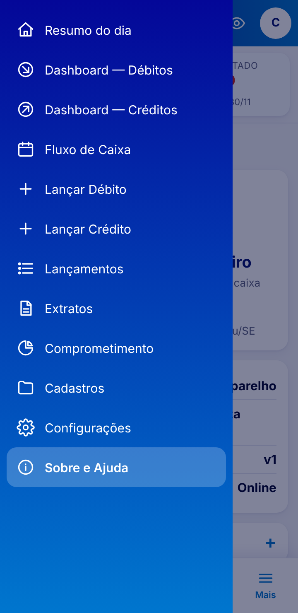

- **Topo:** menu (☰), alertas (sino), ocultar valores (olho) e seu avatar. O ponto verde mostra que o aparelho está online; amarelo significa offline (o app continua funcionando).
- **Barra de baixo:** Resumo, Débitos, o botão **+** no centro (novo lançamento), Fluxo e Mais.
- **Menu (☰):** todas as telas: Resumo, Dashboard dos Débitos, Dashboard dos Créditos, Fluxo de Caixa, Lançar Débito, Lançar Crédito, Extratos, Comprometimento, Cadastros, Configurações e Sobre.

Todos os cartões e números do app são **clicáveis**: ao tocar, você abre a lista dos lançamentos que formam aquele valor.

## 4. Lançar um débito

Toque em **+** e depois em **Lançar débito** (ou use o menu).

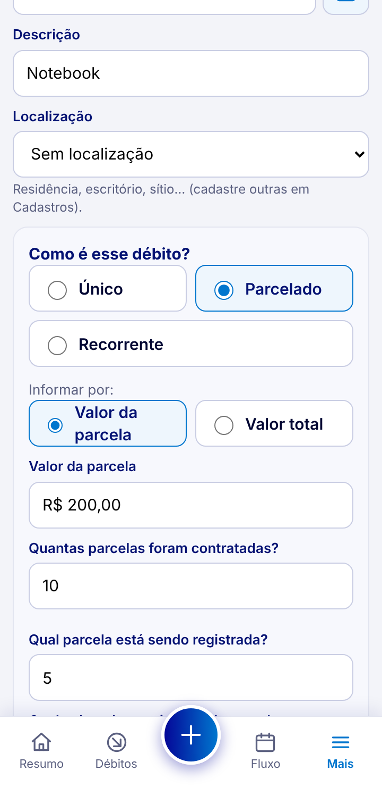

**Campos comuns a todos os débitos**

- **Categoria:** Cartão de crédito, Aluguel, Energia elétrica, Água, Internet, Condomínio, Financiamento, Empréstimo, Seguro, Telefonia, Assinaturas, Mensalidades, Impostos, Despesas pessoais ou Outras despesas. Você cria outras em **Cadastros**.
- **Descrição:** o nome que vai aparecer nas listas. Exemplo: `Notebook`.
- **Localização:** a qual imóvel ou estabelecimento a conta pertence (Residência, Escritório, Sítio…). Pode ficar em branco.
- **Como é esse débito?** **Único** (uma vez só), **Parcelado** ou **Recorrente** (repete todo período).
- **Valor** e **Vencimento:** digite o valor só com números e a data como `12112026` (vira 12/11/2026). O ícone de calendário ao lado abre um seletor.
- **Tipo de obrigação:** Despesa fixa, Parcela ou Outra obrigação. O app sugere sozinho (recorrente de valor fixo = fixa; parcelado = parcela) e você pode trocar. Esse tipo alimenta a análise de comprometimento da renda.
- **Observações:** texto livre.

**Cartão de crédito**

1. Se ainda não tem cartão, abra **+ Cadastrar novo cartão**, digite o nome (`Nubank`) e a instituição, e toque em **Cadastrar cartão**.
2. Em **O que você está lançando?** escolha **Compra individual** ou **Fatura do cartão**. Se você lançar a fatura de um mês, as compras do mesmo cartão que vencem nesse mês deixam de ser somadas, para o mesmo gasto não contar duas vezes.
3. Em compra, informe a **Data da compra**.

**Compra parcelada** (exemplo: notebook em 10x de R$ 200,00, você está na parcela 5)

1. Marque **Parcelado**.
2. Escolha **Informar por: Valor da parcela** (ou **Valor total**; nesse caso o app divide e ajusta os centavos na última parcela).
3. **Valor da parcela:** `20000` (R$ 200,00).
4. **Quantas parcelas foram contratadas?** `10`.
5. **Qual parcela está sendo registrada?** `5`.
6. **Qual a data de vencimento da parcela registrada?** `12/11/2026`.

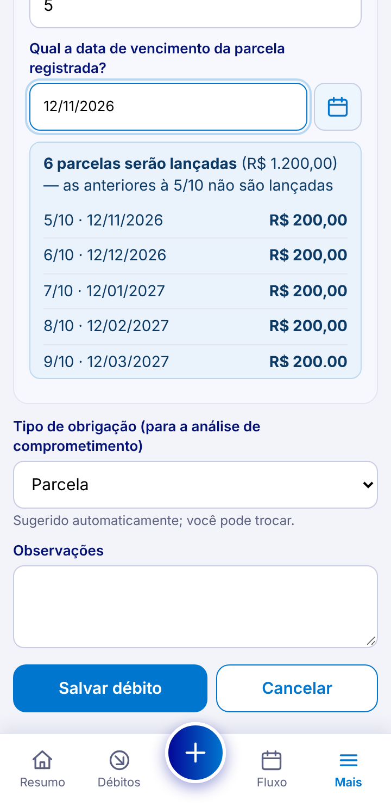

O app mostra a prévia: **6 parcelas** (5/10 até 10/10), cada uma no mesmo dia dos meses seguintes. As parcelas anteriores (1 a 4) **não** são lançadas. Toque em **Salvar débito**.

**Recorrente** (exemplo: aluguel de R$ 1.600,00 todo dia 12)

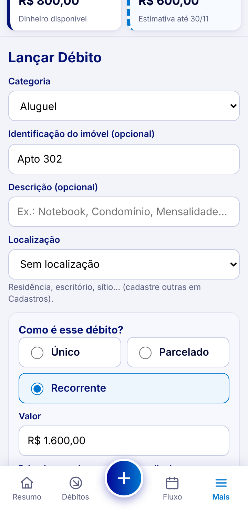

1. Marque **Recorrente**.
2. **Periodicidade:** diária, semanal, quinzenal, mensal, bimestral, trimestral, semestral ou anual.
3. **Primeiro vencimento:** define o dia de vencimento (`12/11/2026`). Em meses curtos o app usa o último dia do mês.
4. **Data de encerramento:** opcional. Em branco, o app mantém gerando os próximos lançamentos.
5. **Valor:** **Fixo** ou **Variável (estimado)**, como a conta de luz. No variável, o valor digitado é a estimativa e você corrige quando a conta chegar.

Os lançamentos futuros entram como **previstos**. Se você tentar lançar um débito idêntico a outro (mesma descrição, valor e vencimento), o app avisa sobre a possível duplicidade.

## 5. Lançar um crédito (entrada de dinheiro)

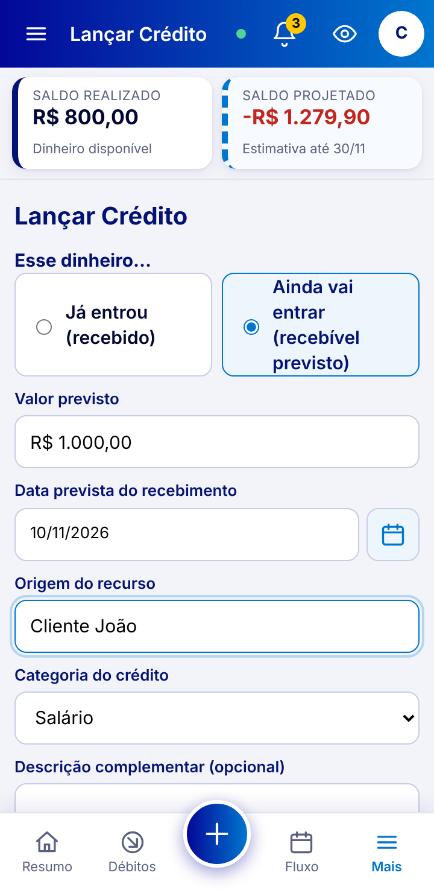

1. **Esse dinheiro…:** **Já entrou (recebido)** ou **Ainda vai entrar (recebível previsto)**. Um recebível previsto **não** soma no saldo realizado.
2. **Valor** e **Data do recebimento** (ou data prevista).
3. **Origem do recurso:** de onde veio. Exemplos: `Salário`, `Cliente João`, `Venda balcão`. O app lembra as origens já usadas.
4. **Categoria do crédito** e **Descrição complementar** (opcional).
5. **Recorrente:** marque se o crédito se repete.

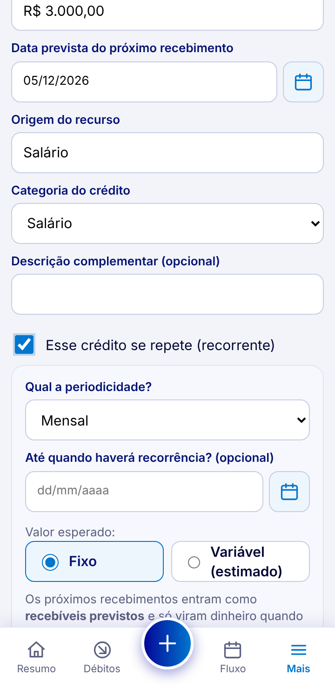

Exemplo de salário: marque **Ainda vai entrar**, valor `300000`, data prevista `05/12/2026`, origem `Salário`, marque **Esse crédito se repete**, periodicidade **Mensal**. Os próximos meses entram como recebíveis previstos.

Você pode lançar **quantas entradas quiser no mesmo dia**. Use **Salvar e lançar outro** para repetir mais rápido.

No **Resumo**, o app pergunta todo dia: **"Houve alguma entrada de capital hoje?"** Toque em **Sim, lançar entrada** ou **Não houve**.

## 6. Resumo do dia

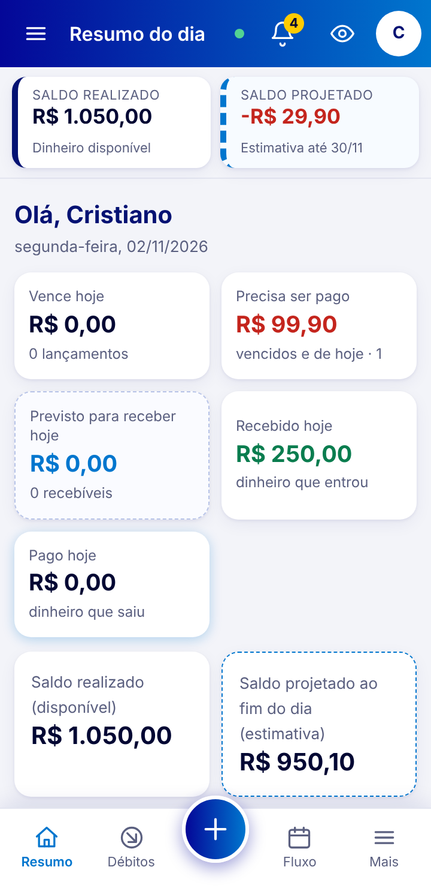

Mostra o que **vence hoje**, o que **precisa ser pago** (vencidos e de hoje), o que está **previsto para receber hoje**, o que **entrou hoje** e o que **saiu hoje**.

### Barras de evolução

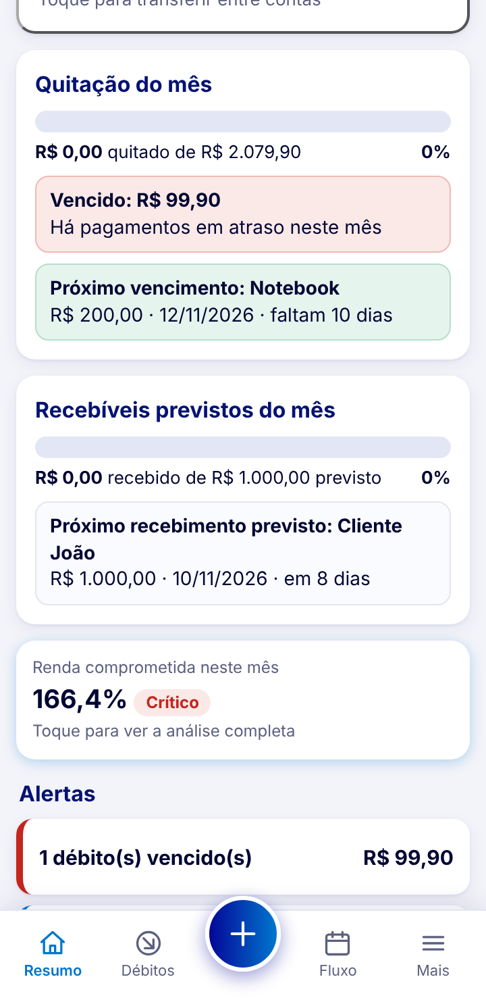

- **Quitação do mês:** quanto do total de débitos do mês já foi pago. Pagamento parcial conta só o valor pago. Abaixo da barra aparece o **próximo vencimento** (descrição, valor, data e "faltam X dias"). A cor avisa: verde longe, amarelo perto (conforme a antecedência dos alertas) e vermelho vencido.
- **Recebíveis previstos do mês:** quanto do que estava previsto para receber no mês já foi **realmente recebido**. O previsto nunca preenche a barra até você confirmar. Abaixo, o **próximo recebimento previsto**.

Toque em qualquer barra para ver a lista detalhada.

## 7. Dashboard dos débitos

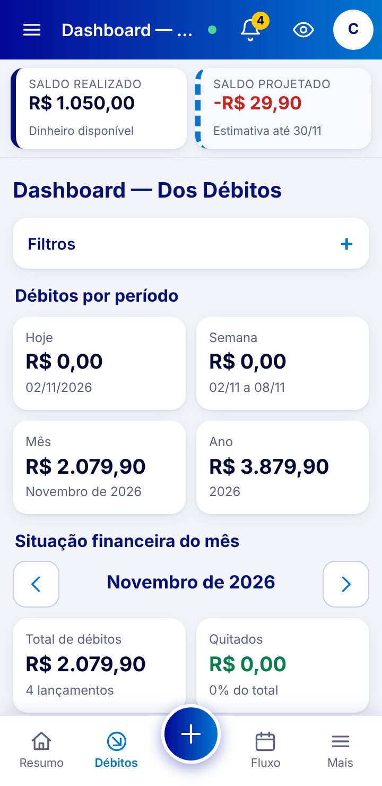

- **Débitos por período:** hoje, semana, mês e ano.
- **Filtros:** categoria, localização, cartão ou instituição, situação e período.

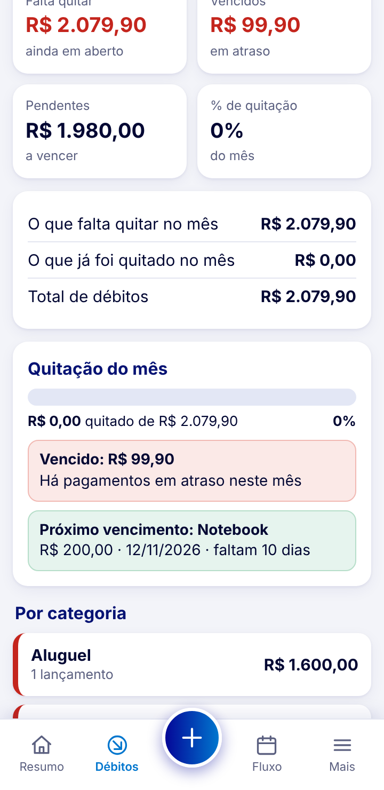

- **Situação financeira do mês:** total de débitos, quitados, pendentes, vencidos, percentual de quitação e **o que falta quitar**. Use as setas para trocar de mês.
- Há um atalho para a análise de comprometimento da renda.

## 8. Dashboard dos créditos

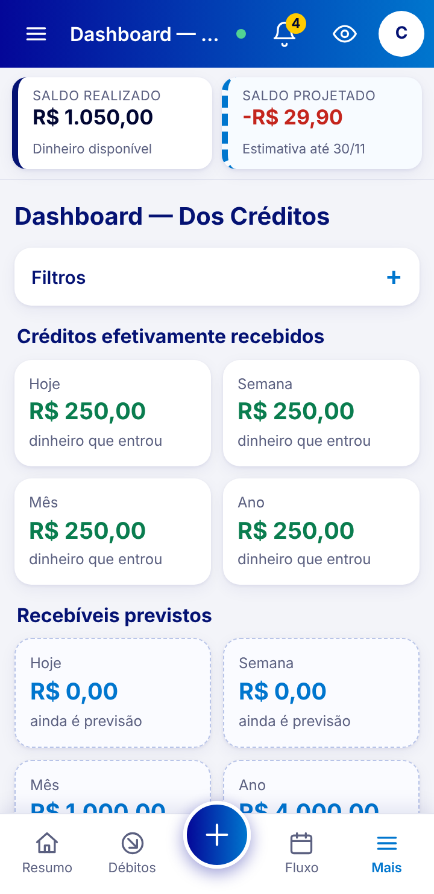

Mostra **separadamente** o que foi recebido e o que é previsto (hoje, semana, mês e ano), além de total pendente de recebimento, recebido parcialmente e inadimplido. Esses dois grupos nunca se misturam.

## 9. Fluxo de caixa

O Fluxo tem três visões, nas abas **Calendário**, **Linha do tempo** e **Lista**.

Na parte de cima ficam os cartões: **Disponível agora (realizado)**, **Comprometido no mês**, **Previsto a receber no mês** e **Poderá sobrar no fim do mês** (estimativa). Um aviso mostra se algum dia do mês fica com saldo projetado negativo.

### Calendário

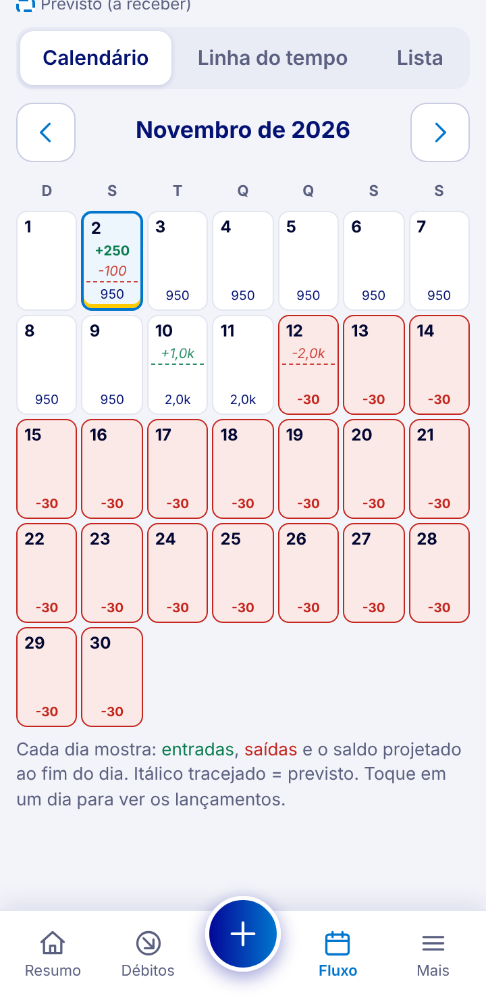

Cada dia mostra as **entradas** (verde), as **saídas** (vermelho) e, embaixo, o **saldo projetado** ao fim do dia. Valores **previstos** aparecem em itálico com traço; os realizados, em negrito. Dias com saldo projetado **negativo** ficam em vermelho, e o dia de hoje fica marcado. Use as setas para mudar de mês.

No exemplo, o dia 10 tem dinheiro entrando, mas no dia 12 vencem várias contas e o saldo projetado fica negativo.

### Detalhe do dia

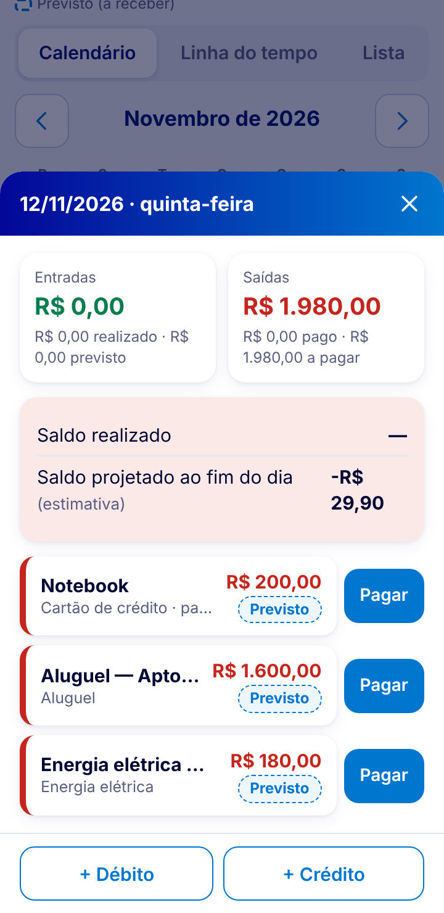

Toque em um dia para ver entradas, saídas, saldos e todos os lançamentos dele. Em cada um, o botão **Pagar** (ou **Receber**) confirma na hora. Embaixo, **+ Débito** e **+ Crédito** já abrem o lançamento com aquela data.

### Linha do tempo

Mostra o saldo projetado por **dia, semana, mês ou ano**. Deslize para ver meses anteriores e futuros.

## 10. Comprometimento da renda

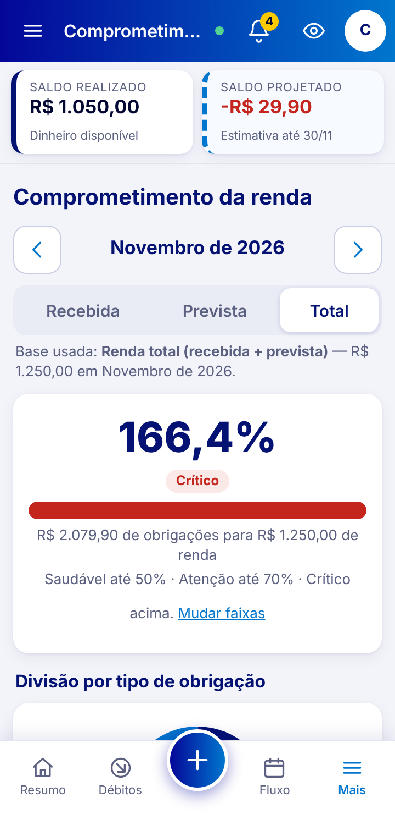

Responde: **quanto da minha renda do mês já está comprometido?**

- Escolha a **base da renda**: **Recebida**, **Prevista** ou **Total (recebida + prevista)**. O app diz qual está usando.
- O **percentual** aparece com a faixa: **Saudável** (até 50%), **Atenção** (até 70%) ou **Crítico** (acima). Toque em **Mudar faixas** para ajustar.
- Mais abaixo: a divisão por tipo (**despesas fixas, parcelas, outras obrigações**), o **comparativo com os meses anteriores** e a **evolução das despesas**.
- Parcelas e faturas contam uma única vez. Sem renda no mês, o app avisa em vez de mostrar um percentual enganoso.

## 11. Lista de lançamentos, detalhe e baixas

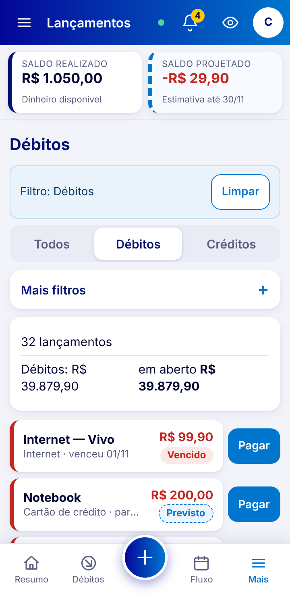

A lista tem as abas **Todos / Débitos / Créditos**, **Mais filtros** (situação, categoria, período, "somente em aberto" e busca por texto) e o botão **Pagar/Receber** em cada linha. As situações são:

- **Débitos:** Previsto, Pendente, Pago parcialmente, Quitado, Vencido, Cancelado.
- **Créditos:** Previsto, Recebido parcialmente, Recebido, Pendente, Inadimplido, Cancelado.

Toque em uma linha para abrir o detalhe.

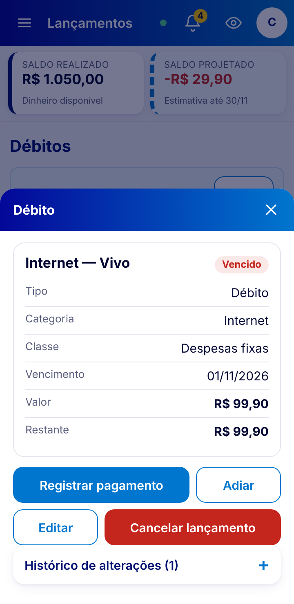

No detalhe você vê todos os dados, os pagamentos já feitos e o **Histórico de alterações**. Os botões:

- **Registrar pagamento / recebimento**
- **Adiar:** muda a data.
- **Não recebido** (créditos): o valor deixa de entrar na projeção e, passada a data, fica como inadimplido.
- **Nova previsão do saldo** (créditos): o que faltou receber vira um novo recebível previsto.
- **Editar:** descrição, valor, data, categoria, localização e observações.
- **Mudar valor daqui pra frente** e **Encerrar recorrência** (lançamentos recorrentes). Só mexem no que ainda está em aberto.
- **Cancelar lançamento:** o lançamento sai dos saldos, mas o histórico fica guardado e você pode **Reabrir**.

### Registrar um pagamento

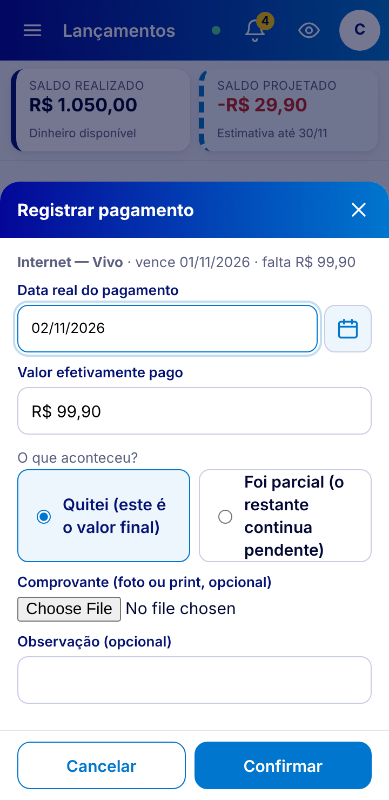

1. **Data real do pagamento:** não pode ser futura.
2. **Valor efetivamente pago:** já vem com o que falta; altere se pagou outro valor.
3. **O que aconteceu?** **Quitei** (este é o valor final) ou **Foi parcial** (o restante continua pendente).
4. **Comprovante:** foto ou print, opcional.
5. **Observação:** opcional. Toque em **Confirmar**.

Ao confirmar, o **saldo realizado** diminui (no pagamento) ou aumenta (no recebimento). O projetado só se ajusta pela diferença.

## 12. Extratos

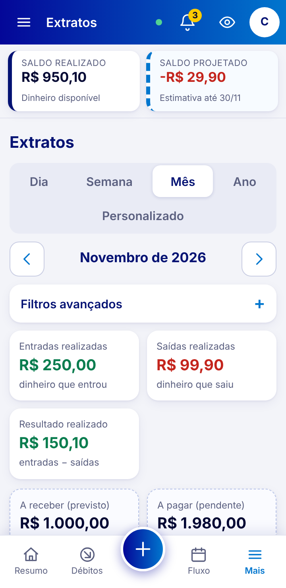

Escolha o período (**dia, semana, mês, ano ou intervalo personalizado**) e abra **Mais filtros** para filtrar por categoria, localização, instituição, origem do crédito, tipo de despesa e situação. O extrato traz data, descrição, categoria, origem ou destino, valor, tipo, situação e vencimento ou recebimento, com os **totais de entradas, saídas e o resultado**.

Botões: **CSV** (para planilha), **PDF** e **Imprimir**.

## 13. Cadastros

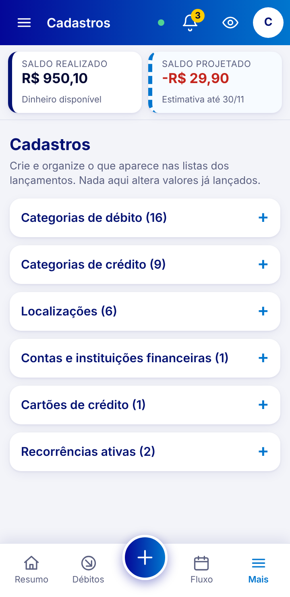

Aqui você cria e edita, sem mexer na estrutura do app: **categorias de débito**, **categorias de crédito**, **localizações**, **instituições financeiras** e **cartões**. As categorias padrão do app e qualquer item que já tem lançamentos não podem ser excluídos (para não perder histórico), mas podem ser renomeados.

## 14. Configurações

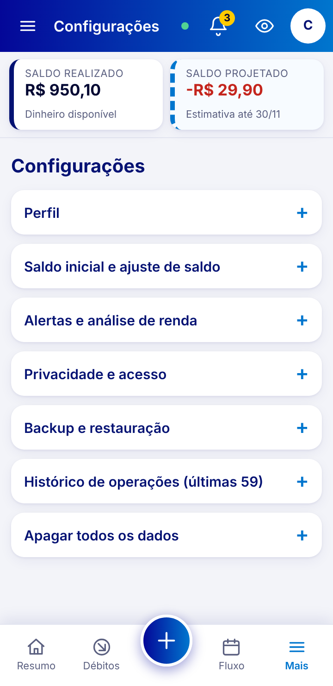

- **Nome** exibido no app.
- **Saldo inicial** e **Ajustar saldo:** se o saldo do banco for diferente do saldo do app, informe o valor real. O app cria um lançamento "Ajuste de saldo" com histórico, sem apagar nada.
- **Alertas e análise de renda:** quantos dias antes do vencimento o app avisa, qual a renda base padrão e as faixas do comprometimento (débitos próximos, vencidos, recebimentos do dia e não confirmados, parcelas futuras, comprometimento excessivo e saldo projetado negativo).
- **Senha do aparelho:** opcional. Protege o acesso ao app e bloqueia sozinho depois de 1, 5, 15 ou 30 minutos fora da tela (você escolhe). Ela não criptografa os dados guardados no aparelho. **Sem a senha não há como abrir os dados**, então guarde um backup.
- **Backup:** **Exportar** baixa um arquivo `.json` com tudo. **Importar** restaura. O arquivo traz a versão do esquema e um campo de origem externa em cada lançamento, preparado para conversar no futuro com outros apps Fênix (Precificação Pro, Recibo Pro e Gestor de Contratos).
- **Apagar tudo:** exige digitar **APAGAR** para liberar o botão.

## 15. Ocultar valores

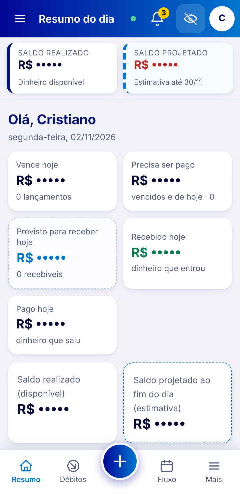

Toque no **olho** no topo: todos os valores em reais viram `•••••`, inclusive saldos e barras. Datas e descrições continuam visíveis. A escolha fica valendo enquanto você navega, até tocar de novo.

## 16. Sobre, Changelog e Manual

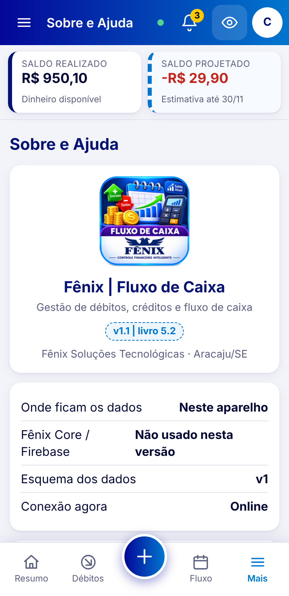

Em **Sobre** ficam a versão do app e do Livro das Regras, onde os dados ficam guardados, o **Changelog** e este **Manual** (para ler e baixar em `.md` ou `.pdf`).

## 17. Onde ficam seus dados

Nesta versão os dados ficam **somente neste aparelho** (no navegador), e o app funciona **sem internet**. Por isso:

- Faça **backup** com frequência (Configurações → Backup → Exportar).
- Trocou de celular? Exporte no antigo e importe no novo.
- Limpar os dados do navegador apaga o app. O backup é a sua garantia.

## 18. Dúvidas comuns

- **O saldo realizado não bate com o banco.** Use **Ajustar saldo**. O app registra o ajuste.
- **Lancei a fatura e a compra e o total não dobrou.** Correto: compra do mesmo cartão e mês de uma fatura lançada não é somada duas vezes.
- **Esqueci a senha do aparelho.** Só é possível apagar tudo e restaurar um backup.
- **Um recebimento não veio.** Abra o lançamento e toque em **Não recebido** ou **Nova previsão do saldo**.

---

**Fênix Soluções Tecnológicas**
